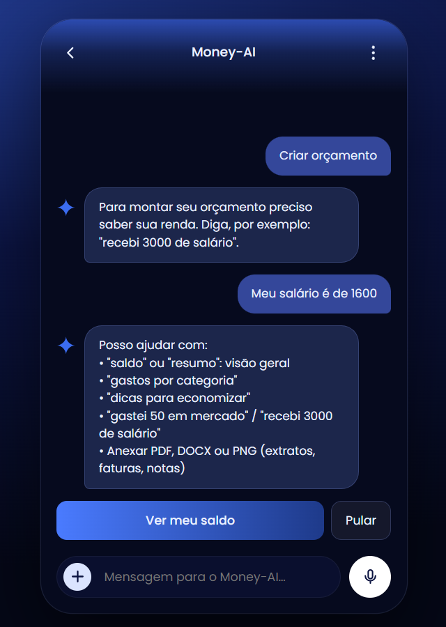

# Money-AI


Assistente financeiro em formato de chat. Você conversa com ele para registrar receitas e despesas, ver o saldo, montar um orçamento, receber dicas de economia e enviar extratos (PDF, DOCX ou PNG) para ele ler.

> **Aviso importante: é uma IA básica da básica.**
> O Money-AI **não usa modelo de linguagem** (como ChatGPT ou Claude). Ele funciona por **regras e palavras-chave**: reconhece frases curtas como "gastei 50 em mercado" ou "criar orçamento" e responde com base nos dados salvos no MySQL. Ele foi feito para estudo e como ponto de partida, não como consultoria financeira.

O visual foi **inspirado em um design encontrado no Pinterest** (_AI financial assistant – AI chat interface_, de Colibri UX/UI), adaptado para tons de azul-marinho. O código e a implementação são originais deste projeto.

## Telas

<table>
  <tr>
    <td align="center"><b>Tela principal</b></td>
    <td align="center"><b>Chat da IA</b></td>
  </tr>
  <tr>
    <td></td>
    <td></td>
  </tr>
</table>

## Sumário

- [O que ele faz](#o-que-ele-faz)
- [Tecnologias](#tecnologias)
- [Como clonar](#como-clonar)
- [Instalando as dependências](#instalando-as-dependências)
- [Configuração](#configuração)
- [Como rodar](#como-rodar)
- [Comandos que o chat entende](#comandos-que-o-chat-entende)
- [Testes](#testes)
- [API](#api)
- [Estrutura do projeto](#estrutura-do-projeto)
- [Problemas comuns](#problemas-comuns)
- [Limitações e ideias futuras](#limitações-e-ideias-futuras)
- [Como contribuir](#como-contribuir)
- [Licença](#licença)

## O que ele faz

- **Chat financeiro:** pergunte o saldo, peça um orçamento 50/30/20, veja seus gastos por categoria e receba dicas.
- **Registro por texto:** escreva "gastei 50 em mercado" ou "recebi 3000 de salário" e o lançamento é salvo.
- **CRUD de lançamentos:** criar, listar, editar e excluir receitas e despesas pelo menu ⋮ da tela.
- **Leitura de arquivos:** envie PDF, DOCX ou PNG (com OCR) e ele encontra os valores em reais.
- **Voz:** o botão branco vira microfone (em navegadores compatíveis) e preenche a mensagem falada em português.

## Tecnologias

| Parte               | Tecnologias                                                             |
| ------------------- | ----------------------------------------------------------------------- |
| Backend             | Java 17, Spring Boot 3.3, Spring Data JPA, MySQL 8                      |
| Leitura de arquivos | Apache PDFBox (PDF), Apache POI (DOCX), Tess4J + Tesseract (OCR de PNG) |
| Frontend            | HTML, CSS e JavaScript puro (módulos ES), sem frameworks                |
| Testes              | JUnit 5, Mockito, AssertJ, Node Test Runner                             |

## Como clonar

Você precisa do [Git](https://git-scm.com/downloads) instalado.

```bash
git clone https://github.com/luisaanny74-a11y/money-ai.git
cd money-ai
```

> Troque https://github.com/luisaanny74-a11y pelo usuário (ou organização) dono do repositório.

Dentro da pasta clonada você verá `backend/`, `frontend/`, `docs/`, `LICENSE` e este `README.md`. Os comandos abaixo partem da pasta `money-ai`.

## Instalando as dependências

Você precisa instalar **programas no computador** (uma vez) e depois **baixar as bibliotecas do projeto** com o Maven (que faz isso sozinho).

| Programa                           | Versão | Para quê                                                         |
| ---------------------------------- | ------ | ---------------------------------------------------------------- |
| Java (JDK)                         | **17** | rodar o backend                                                  |
| Maven                              | 3.9+   | baixar as bibliotecas e compilar                                 |
| MySQL                              | 8+     | guardar os lançamentos                                           |
| Tesseract OCR (+ idioma português) | 5+     | ler imagens PNG (opcional se não for usar PNG)                   |
| Node.js                            | 20+    | servir o frontend e rodar os testes dele (alternativa: Python 3) |

### Windows (PowerShell)

```powershell
winget install Git.Git
winget install EclipseAdoptium.Temurin.17.JDK
winget install Oracle.MySQL
winget install UB-Mannheim.TesseractOCR
winget install OpenJS.NodeJS.LTS
```

O **Maven não está no winget**. Instale com o Scoop (não precisa de administrador):

```powershell
Set-ExecutionPolicy -ExecutionPolicy RemoteSigned -Scope CurrentUser
irm get.scoop.sh | iex
scoop install main/maven
```

Alternativa: com o Chocolatey, `choco install maven` (como administrador).

**Feche e abra o terminal** e confira o PATH. O instalador do Tesseract e o do MySQL nem sempre colocam o programa no PATH. Se `tesseract` ou `mysql` não forem reconhecidos, adicione a pasta na sessão atual (ajuste o nome da pasta do MySQL à sua versão):

```powershell
$env:Path += ";C:\Program Files\Tesseract-OCR"
$env:Path += ";C:\Program Files\MySQL\MySQL Server 8.4\bin"
```

Se o Windows tiver outro Java (como o 21 ou o 24), aponte para o 17 **no terminal onde for rodar o projeto**:

```powershell
$env:JAVA_HOME = "C:\Program Files\Eclipse Adoptium\jdk-17.0.x-hotspot"   # use o nome real da pasta
$env:Path = "$env:JAVA_HOME\bin;$env:Path"
```

Se o `tesseract --list-langs` não mostrar `por`, baixe o idioma (PowerShell como administrador):

```powershell
Invoke-WebRequest "https://github.com/tesseract-ocr/tessdata/raw/main/por.traineddata" -OutFile "C:\Program Files\Tesseract-OCR\tessdata\por.traineddata"
```

### Linux (Ubuntu/Debian)

```bash
sudo apt update
sudo apt install -y git openjdk-17-jdk maven mysql-server tesseract-ocr tesseract-ocr-por

# Node.js 22 (para o frontend e os testes dele)
curl -fsSL https://deb.nodesource.com/setup_22.x | sudo -E bash -
sudo apt install -y nodejs

# Inicia o MySQL e define a senha do root
sudo systemctl start mysql
sudo mysql -e "ALTER USER 'root'@'localhost' IDENTIFIED WITH mysql_native_password BY 'sua_senha'; FLUSH PRIVILEGES;"
```

### macOS (Homebrew)

```bash
brew install git openjdk@17 maven mysql tesseract tesseract-lang node
sudo ln -sfn "$(brew --prefix)/opt/openjdk@17/libexec/openjdk.jdk" /Library/Java/JavaVirtualMachines/openjdk-17.jdk
export JAVA_HOME=$(/usr/libexec/java_home -v 17)

brew services start mysql
mysql -u root -e "ALTER USER 'root'@'localhost' IDENTIFIED BY 'sua_senha'; FLUSH PRIVILEGES;"
```

### Conferir se tudo foi instalado

```bash
java -version               # deve mostrar 17
mvn -version
mysql --version
tesseract --list-langs      # deve listar "por"
node --version              # 20 ou superior
```

### Baixar as bibliotecas do projeto

```bash
cd backend
mvn clean install -DskipTests
```

O Maven baixa sozinho Spring Boot, MySQL Connector, PDFBox, Apache POI, Tess4J, JUnit e Mockito. A primeira vez demora alguns minutos. O frontend não tem dependências para baixar.

## Configuração

O banco `money_ai` e a tabela são criados automaticamente na primeira execução.

| O quê                               | Como configurar             | Padrão                                      |
| ----------------------------------- | --------------------------- | ------------------------------------------- |
| Usuário do MySQL                    | variável `DB_USER`          | `root`                                      |
| Senha do MySQL                      | variável `DB_PASS`          | `root`                                      |
| Pasta de idiomas do Tesseract       | variável `TESSDATA_PATH`    | `/usr/share/tesseract-ocr/5/tessdata`       |
| Origens permitidas pelo CORS        | variável `FRONTEND_ORIGINS` | qualquer porta em `localhost` e `127.0.0.1` |
| Endereço da API usado pelo frontend | `frontend/js/config.js`     | `http://localhost:8080`                     |

Defina as variáveis no terminal onde for rodar o backend. **Use a senha que você criou ao instalar o MySQL.**

```bash
# Linux / macOS
export DB_USER=root
export DB_PASS=sua_senha
export TESSDATA_PATH=/usr/share/tesseract-ocr/5/tessdata   # macOS: /opt/homebrew/share/tessdata
```

```powershell
# Windows (PowerShell)
$env:DB_USER="root"
$env:DB_PASS="sua_senha"
$env:TESSDATA_PATH="C:\Program Files\Tesseract-OCR\tessdata"
```

## Como rodar

São duas partes, cada uma em um terminal. **Deixe as duas abertas ao mesmo tempo.**

**Terminal 1: backend (porta 8080)**

```bash
cd backend
mvn spring-boot:run
```

Espere aparecer `Started MoneyAiApplication`.

**Terminal 2: frontend (porta 5500)**

```bash
cd frontend
npx serve -l 5500
```

Sem Node, use Python: `python -m http.server 5500`.

Abra no navegador: **http://localhost:5500**

> Abra sempre por `localhost`. O frontend usa módulos ES, então não funciona com duplo clique no `index.html`. Também não use o endereço "Network" que o `serve` mostra (como `169.254...`), porque o navegador bloqueia a comunicação com o backend (CORS).

Para testar só a API, sem a tela:

```bash
curl -X POST http://localhost:8080/api/chat -H "Content-Type: application/json" -d '{"message":"ver meu saldo"}'
```

## Comandos que o chat entende

O Money-AI entende frases curtas e específicas. Você também pode usar os atalhos da tela inicial.

| Você escreve                | O que acontece                                                              |
| --------------------------- | --------------------------------------------------------------------------- |
| `ver meu saldo` ou `resumo` | mostra receitas, despesas e saldo                                           |
| `analisar gastos`           | lista as despesas por categoria                                             |
| `criar orçamento`           | divide sua renda em 50% essenciais, 30% desejos e 20% reserva               |
| `dicas de economia`         | analisa quanto da renda você gasta e sugere o próximo passo                 |
| `aprender a investir`       | explica a ordem básica para começar (educação financeira, não recomendação) |
| `gastei 50 em mercado`      | registra uma despesa de R$ 50,00 em "Mercado"                               |
| `recebi 3000 de salário`    | registra uma receita de R$ 3.000,00 em "Salário"                            |
| botão **+**                 | envia um PDF, DOCX ou PNG para ele ler                                      |

> Frases livres como "meu salário é de 1600" ainda **não** são entendidas. Use `recebi 1600 de salário`.

## Testes

```bash
# backend (JUnit 5 + Mockito)
cd backend
mvn test

# frontend (Node 20+, sem dependências)
cd frontend
npm test
```

- `AdvisorServiceTest`: interpretação das mensagens, saldo, categorias, orçamento, dicas e análise de documentos.
- `DocumentValueExtractorTest`: extração de valores em reais.
- `TransactionServiceTest`: regras do CRUD (categoria e data padrão, item não encontrado).
- `TransactionControllerTest`: códigos HTTP e JSON que o frontend consome, incluindo os erros 400 e 404.
- `DocumentReaderServiceTest`: leitura de PDF e DOCX gerados em memória. O OCR de PNG depende do Tesseract e não é coberto.
- `frontend/tests/api.test.js`: rotas, métodos, corpo das requisições e tratamento de erros.

## API

| Método | Rota                     | Ação                        |
| ------ | ------------------------ | --------------------------- |
| GET    | `/api/transactions`      | listar lançamentos          |
| GET    | `/api/transactions/{id}` | buscar um lançamento        |
| POST   | `/api/transactions`      | criar                       |
| PUT    | `/api/transactions/{id}` | atualizar                   |
| DELETE | `/api/transactions/{id}` | excluir                     |
| POST   | `/api/chat`              | enviar uma mensagem ao chat |
| POST   | `/api/chat/upload`       | enviar PDF, DOCX ou PNG     |

Exemplo de corpo para criar um lançamento:

```json
{
  "description": "Mercado",
  "amount": 50.5,
  "type": "EXPENSE",
  "category": "Mercado",
  "date": "2026-11-03"
}
```

`type` aceita `INCOME` (receita) ou `EXPENSE` (despesa). `category` e `date` são opcionais.

## Estrutura do projeto

```
money-ai/
├── backend/                 API em Java (Spring Boot + MySQL)
│   ├── src/main/java/com/moneyai/
│   │   ├── config/          CORS
│   │   ├── controller/      rotas HTTP
│   │   ├── service/         assistente, lançamentos e leitura de arquivos
│   │   ├── repository/      acesso ao MySQL
│   │   ├── model/ dto/      entidade e objetos de entrada/saída
│   │   └── exception/       tratamento de erros
│   ├── src/test/java/       testes (JUnit 5 + Mockito)
│   └── schema.sql           criação manual do banco (opcional)
├── frontend/                interface web
│   ├── index.html
│   ├── css/style.css
│   ├── js/                  config, api, chat, transactions, sheet, ui, main
│   └── tests/               testes (Node)
├── docs/images/             imagens usadas neste README
├── LICENSE
└── README.md
```

## Problemas comuns

| Sintoma                                                             | Causa e solução                                                                                      |
| ------------------------------------------------------------------- | ---------------------------------------------------------------------------------------------------- |
| `mvn` não é reconhecido                                             | O Maven não está instalado ou o terminal é antigo. Instale (veja acima) e **abra um terminal novo**. |
| `Unsupported class file version` ou testes falhando                 | Você está com outro Java. Use o **17** (veja o `JAVA_HOME` acima).                                   |
| `Access denied for user 'root'`                                     | A senha em `DB_PASS` não é a do seu MySQL.                                                           |
| `Communications link failure`                                       | O MySQL não está rodando. Linux: `sudo systemctl start mysql`. Windows: `Get-Service MySQL*`.        |
| A tela abre, mas o chat não responde; erro de CORS no console (F12) | Abra por `http://localhost:5500` (não por IP). Para outro endereço, defina `FRONTEND_ORIGINS`.       |
| Mensagem "Não consegui falar com o servidor"                        | O backend está desligado. Suba o Terminal 1.                                                         |
| Página em branco                                                    | Abra por um servidor (`npx serve`), não por duplo clique.                                            |
| Porta 8080 ou 5500 ocupada                                          | Feche o outro programa, ou troque a porta e ajuste `frontend/js/config.js`.                          |
| Envio de PNG falha                                                  | Instale o Tesseract com o idioma `por` e confira `TESSDATA_PATH`.                                    |
| `favicon.ico` 404 no console                                        | Inofensivo: é só o ícone da aba, que o projeto não tem.                                              |
| Build lento ou com arquivo bloqueado                                | Pastas do OneDrive podem travar o Maven. Copie o projeto para fora do OneDrive (ex.: `C:\dev`).      |

## Limitações e ideias futuras

**Limitações atuais**

- Entende só frases curtas e específicas (veja a tabela de comandos).
- Não tem login: todos os lançamentos ficam num único banco, sem separar por usuário.
- A leitura de arquivos encontra e soma valores em reais, mas ainda não cria os lançamentos sozinha a partir do documento.

**Ideias para evoluir** (não implementadas)

- Ligar o chat a um modelo de linguagem para entender frases livres.
- Importar os valores de um extrato direto como lançamentos.
- Login e dados separados por usuário.

## Como contribuir

1. Faça um _fork_ do repositório.
2. Crie uma branch: `git checkout -b minha-melhoria`.
3. Faça as mudanças e rode os testes (`mvn test` e `npm test`).
4. Envie um _Pull Request_ explicando o que mudou.

## Licença

Distribuído sob a **Licença MIT**: você pode usar, copiar, modificar e distribuir este projeto gratuitamente, inclusive em projetos comerciais, mantendo o aviso de copyright. Veja o arquivo [LICENSE](LICENSE).

## Créditos

- Design de referência: _AI financial assistant – AI chat interface_, de Colibri UX/UI, encontrado no Pinterest. Este projeto é uma adaptação independente, sem vínculo com o autor original.
- Fonte [Poppins](https://fonts.google.com/specimen/Poppins) (Google Fonts, licença OFL).
